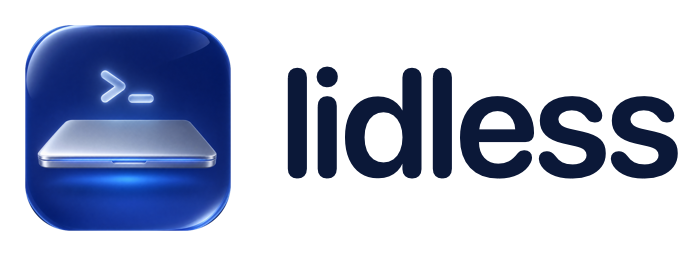
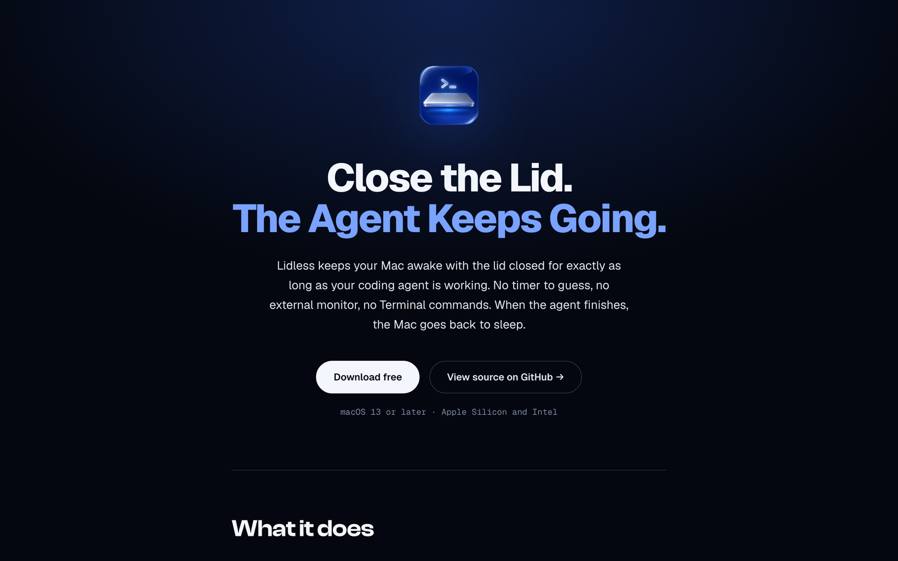
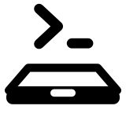
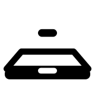

<div align="center">

<a href="https://lidless-gamma.vercel.app">
  <picture>
    <source media="(prefers-color-scheme: dark)" srcset="app/brand/logo-dark.png">
    
  </picture>
</a>

### Close the lid. The agent keeps going.

Lidless keeps your Mac awake with the lid closed for exactly as long as your coding agent is working, then lets it sleep. No timer to pick.

[**Download**](../../releases/latest) · [Website](https://lidless-gamma.vercel.app) · [How it knows](#how-it-knows) · [Install](#install) · [Report an issue](../../issues)


</div>

---

<p align="center">
  
</p>

## Features

- **Awake with the lid closed** while an agent works. No external monitor, no Terminal commands.
- **Ends when the agent ends.** The moment the last agent finishes, normal sleep is back. If the lid is shut, the Mac sleeps within seconds.
- **Exact for Claude Code and Codex.** Hooks are added in the background and report every turn's start and finish.
- **Works with the rest by activity:** Gemini CLI, Aider, OpenCode, Cursor Agent, Goose, Amp, Qwen Code, Crush, Droid, Copilot CLI.
- **Wrap anything else** with `lidless run -- <command>`.
- **Safety guards.** Lets go at 20% battery on battery power, on a critical thermal state, and on quit. A crash is repaired on next launch.

## How it knows

| Agent | Signal | Precision |
| --- | --- | --- |
| Claude Code | `UserPromptSubmit` starts, `Stop` and `SessionEnd` end (`~/.claude/settings.json`) | Exact |
| Codex CLI | `UserPromptSubmit` starts, `Stop`, `Interrupt` and `SessionEnd` end (`~/.codex/hooks.json`) | Exact, after Codex's one-time hook review |
| Everything else | The agent or anything it spawned is using CPU; released after two quiet minutes | Close |
| `lidless run -- <cmd>` | The command is running | Exact |

The menubar icon is a closed laptop:

|  |  |  |
| :---: | :---: | :---: |
| An agent is working | Waiting for an agent | Paused by the battery or heat guard |

## Install

1. Download `Lidless.zip` from the [latest release](../../releases/latest).
2. Drag **Lidless.app** into **Applications** and open it.
3. Click **Set Up**. macOS asks for your password once.

> [!IMPORTANT]
> Lidless is not notarized yet. The first time, right-click **Lidless.app** and choose **Open**. On macOS 15 and later, use **System Settings > Privacy & Security > Open Anyway**.

> [!NOTE]
> **What Set Up changes.** It adds `/etc/sudoers.d/lidless`, which lets your user run exactly two commands without a password: `pmset -a disablesleep 1` and `pmset -a disablesleep 0`. It links `lidless` into `/usr/local/bin`. Hooks for Claude Code and Codex are added in the background (plus `codex_hooks = true` in `~/.codex/config.toml`), each with a backup of the original file. **Uninstall** in the menu removes all of it.

Requires macOS 13 or later. Universal binary for Apple Silicon and Intel.

## Safety

Use it at your own risk. The command Lidless runs is Apple's own, and it only runs while an agent is actually working. Keep the Mac on a hard surface and never put it in a bag mid-run: a closed laptop in a bag with sleep disabled will overheat.

## Privacy

No network access, no account, no telemetry. Lidless reads the local process list and runs `pmset`. State lives in `~/Library/Application Support/Lidless/`.

## Command line

```bash
lidless run -- npm run e2e        # stay awake until the command exits
lidless status                    # what Lidless is holding for
```

## Build

Requires Xcode command line tools. No third-party packages.

```bash
app/build.command                 # builds universal, runs the self-test, installs to /Applications, and opens Lidless
app/build.command --no-install    # build and self-test only
```

| Command or variable | Effect |
| --- | --- |
| `Lidless --self-test` | Agent matching, hold files, hook merging, Codex config and sudoers checks |
| `Lidless --render-icons <dir>` | Writes the menubar icon states as PNGs |
| `LIDLESS_HOME=/path` | Use a scratch state folder instead of the real one |

```
app/Sources/   Menubar app, monitor, hooks, power control and CLI (AppKit)
app/Resources/ App icon (Icon Composer)
app/brand/     Icon art, wordmarks and the scripts that render them
website/       Landing page (static, deployed on Vercel)
docs/          README images
```

## Release

```bash
app/build.command --no-install
ditto -c -k --keepParent app/.build/Lidless.app Lidless.zip
gh release create v<version> Lidless.zip --title "Lidless <version>" --notes-file notes.md
```
